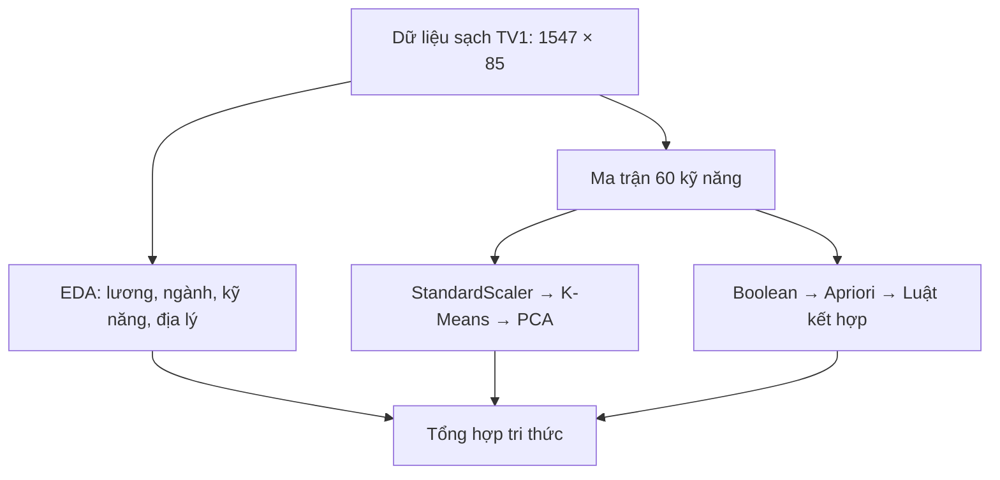

# 📘 BÁO CÁO HỌC THUẬT & CẨM NANG BẢO VỆ ĐỒ ÁN KHAI PHÁ DỮ LIỆU (`ITEC3417`) — THÀNH VIÊN 2

> **Tên đề tài:** Thu thập và Khai phá Dữ liệu Tuyển dụng Thực tế nhóm ngành Dữ liệu & Trí tuệ Nhân tạo (*Data Analytics, Data Engineering, Data Science, BI, AI/ML*) tại Việt Nam  
> **Học phần:** Khai Phá Dữ Liệu (`ITEC3417`)  
> **Thành viên thực hiện:** Ngô Hoàng Long  
> **Phạm vi phụ trách:** Thành viên 2 (33% khối lượng đồ án theo phân công nhóm) — EDA, K-Means và Apriori / FP-Growth.  
> **Nhánh Git:** `thanh-vien-2`  
> **Ngày:** 17/11/2026  
> **Sản phẩm bàn giao:** [TV2_EDA_Clustering_Apriori.ipynb](notebooks/TV2_EDA_Clustering_Apriori.ipynb), `BAO_CAO_THANH_VIEN_2.md`.

---

## PHẦN 1: BIÊN BẢN PHÂN CÔNG NHIỆM VỤ (WORK BREAKDOWN STRUCTURE - WBS)

Khai thác dữ liệu tuyển dụng đã được Thành viên 1 thu thập và làm sạch để mô tả thị trường lao động ngành Data, khám phá các nhóm nghề nghiệp theo yêu cầu kỹ năng và xác định những tổ hợp kỹ năng thường xuất hiện cùng nhau.

| Thành viên | Đóng góp | Hạng mục | Đầu ra |
|---|---:|---|---|
| Thành viên 1 | 34% | Thu thập và tiền xử lý | `data/clean_data.csv`, Pipeline TV1 |
| **Thành viên 2** | **33%** | **2.2 EDA; 2.3 K-Means; 2.4 Apriori** | Notebook TV2, bảng thống kê, biểu đồ, bảng hồ sơ cụm, danh sách luật và báo cáo |
| Thành viên 3 | 33% | Phân lớp, đánh giá và tổng hợp | Decision Tree / Random Forest, báo cáo chung |

Theo bảng WBS của nhóm, trọng số hạng mục kỹ thuật 2.2, 2.3, 2.4 lần lượt ghi 10%, 15%, 15%; đây là các trọng số trong bảng nhiệm vụ, không cộng lại thành tỷ lệ đóng góp cá nhân 33%.

---

## PHẦN 2: TỔNG QUAN ĐỀ TÀI & DỮ LIỆU ĐẦU VÀO

### 2.1. Câu hỏi nghiên cứu

1. Mức lương công bố, địa lý và mô hình làm việc khác nhau như thế nào giữa các phân khúc Data?
2. Nếu không dùng tên chức danh làm đầu vào, 60 kỹ năng có thể tạo ra những chân dung nghề nghiệp nào?
3. Các kỹ năng nào thường được nhắc đến cùng nhau, và những luật nào có Support, Confidence và Lift đủ lớn để tham khảo?

### 2.2. Dữ liệu và môi trường thực hiện

- Nguồn dữ liệu: `data/clean_data.csv`, sản phẩm tiền xử lý của Thành viên 1.
- Quy mô: 1.547 tin tuyển dụng, 85 thuộc tính, trong đó có 60 thuộc tính kỹ năng nhị phân (0/1).
- Nguồn thu thập gồm các trang tuyển dụng như TopCV, TopDev, VietnamWorks và ITviec.
- Môi trường: Python 3.12.7, `.venv`, VS Code, Jupyter Notebook.
- Thư viện: pandas, NumPy, Matplotlib, Seaborn, scikit-learn, mlxtend.
- Chỉ đọc dữ liệu nguồn; kết quả phân cụm được lưu trong bản sao DataFrame, không ghi đè dữ liệu của Thành viên 1.



---

## PHẦN 3: NỘI DUNG HOÀN CHỈNH CHƯƠNG 2 — EDA, K-MEANS & APRIORI

### Bước 2.2 – Phân tích khám phá dữ liệu (EDA)

#### 2.2.1. Phân bố nhóm ngành

| Nhóm ngành | Số tin | Tỷ lệ (%) |
|---|---:|---:|
| Database / Data Platform & Ops | 527 | 34,07 |
| Data Engineer / Big Data | 323 | 20,88 |
| Data Scientist / AI & ML | 308 | 19,91 |
| Data Analyst / BI | 296 | 19,13 |
| Data-Driven Software Engineer | 93 | 6,01 |
| **Tổng** | **1.547** | **100,00** |

**Nhận xét:** Database / Data Platform & Ops là nhóm chiếm tỷ trọng lớn nhất trong mẫu khảo sát. Điều này phản ánh sự hiện diện đáng kể của các công việc liên quan đến cơ sở dữ liệu và vận hành nền tảng dữ liệu trong nguồn tin thu thập, không đồng nghĩa với thị phần chính xác của toàn bộ thị trường Việt Nam.

#### 2.2.2. Thống kê và phân phối mức lương

Chỉ sử dụng các tin có `Trang_Thai_Luong = Co_Cong_Bo` và `Luong_Trung_Binh` không thiếu, nhằm tránh trộn lương được công bố với lương điền khuyết.

| Trạng thái lương | Số tin | Tỷ lệ (%) |
|---|---:|---:|
| Có công bố | 391 | 25,27 |
| Thỏa thuận | 1.156 | 74,73 |

| Chỉ số thống kê | Giá trị (triệu VNĐ/tháng) |
|---|---:|
| Trung bình | 28,04 |
| Trung vị | 25,50 |
| Độ lệch chuẩn | 16,71 |
| Nhỏ nhất | 3,40 |
| Q1 | 19,00 |
| Q3 | 35,00 |
| Lớn nhất | 215,90 |

**Histogram:** Phân phối lệch phải; phần lớn mức lương quan sát tập trung khoảng 15–40. Trung bình cao hơn trung vị, phù hợp với sự xuất hiện của một số mức lương rất cao. Trung vị là thước đo hữu ích khi phân phối không đối xứng.

**Boxplot:** So sánh trung vị, khoảng tứ phân vị và độ phân tán mức lương giữa năm nhóm ngành. Các điểm nằm ngoài râu hộp được thể hiện trực quan, nhưng chưa được kiểm tra tính hợp lệ riêng. Không tự động loại bỏ các mức lương cao. Phần tính và liệt kê ngoại lệ theo IQR chưa được triển khai riêng trong Notebook.

Đối chiếu thống kê lương công bố trong `BAO_CAO_THANH_VIEN_1.md`:

| Nhóm ngành | Mean (triệu/tháng) | Median (triệu/tháng) |
|---|---:|---:|
| Data Scientist / AI & ML | 33,77 | 27,50 |
| Data Engineer / Big Data | 28,82 | 27,00 |
| Data Analyst / BI | 26,25 | 25,00 |
| Database / Data Platform & Ops | 25,96 | 25,00 |
| Data-Driven Software Engineer | 24,35 | 22,18 |

**Cơ sở thống kê IQR:** $IQR=Q_3-Q_1=35-19=16$. Ngưỡng toàn mẫu là $19-1.5(16)=-5$ và $35+1.5(16)=59$ triệu/tháng. Đây là phép tính minh họa từ thống kê đã có, không phải kết quả đếm hoặc loại ngoại lệ trong Notebook. Khi xét từng nhóm, phải tính Q1 và Q3 riêng cho nhóm đó.

**Code Audit:** ô `2.2.2` lọc `Co_Cong_Bo` rồi dùng `sns.histplot(salary, bins=30, kde=True)`; ô `2.2.3` gọi `sns.boxplot()` trên `df_salary`. Các đường Mean/Median được vẽ bằng `plt.axvline()`.

**Hạn chế:** Chỉ 25,27% số tin có lương công bố; kết quả không thể xem là đại diện chắc chắn cho toàn bộ 1.547 tin. Mức lương giữa các nhóm còn có thể khác nhau do kinh nghiệm, cấp bậc và địa điểm.

#### 2.2.3. Phân tích tương quan kỹ năng

Tạo ma trận Pearson kích thước 60 × 60 từ các cột `Skill_`. Với hai biến nhị phân, Pearson tương ứng với hệ số phi. Heatmap sử dụng thang màu từ -1 đến +1; đồng thời trích xuất 10 cặp tương quan dương cao nhất, loại bỏ đường chéo và các cặp trùng lặp.

- Hệ số dương: hai kỹ năng có xu hướng đồng xuất hiện.
- Hệ số âm: hai kỹ năng có xu hướng ít đồng xuất hiện hơn kỳ vọng độc lập.
- Hệ số gần 0: ít liên hệ tuyến tính.

Tương quan không chứng minh quan hệ nhân quả. Các hệ số cụ thể được trình bày trong Notebook.

#### 2.2.4. Địa lý và mô hình làm việc

- Thống kê `Dia_Diem_Chuan` và vẽ biểu đồ cột 10 địa điểm có số tin cao nhất.
- Thống kê số lượng và tỷ lệ theo `Mo_Hinh_Lam_Viec`, trực quan hóa bằng biểu đồ tròn.
- Sử dụng bảng chéo và biểu đồ cột chồng 100% để so sánh cơ cấu mô hình làm việc giữa năm nhóm ngành.

Các biểu đồ giúp nhận diện nơi tập trung nhiều tin tuyển dụng và mức độ phổ biến của từng mô hình làm việc trong mẫu. Số liệu chi tiết nằm trong các ô kết quả tương ứng của Notebook; không suy diễn tỷ lệ khi chưa có bảng kết quả xác nhận.

Theo số liệu đối chiếu từ báo cáo Thành viên 1, Hà Nội có 869 tin (56,2%), TP.HCM có 561 tin (36,3%). Mô hình On-site chiếm 1.401 tin (90,6%), Hybrid 102 tin (6,6%) và Remote 44 tin (2,8%). Hai trung tâm lớn chiếm phần lớn mẫu tuyển dụng; làm việc tại văn phòng phổ biến hơn làm việc từ xa. Không thể kết luận nguyên nhân chỉ từ tần suất.

### Bước 2.3 – Phân cụm K-Means

#### 2.3.1. Chuẩn bị và chuẩn hóa đặc trưng

Mỗi tin tuyển dụng được biểu diễn bằng vector 60 kỹ năng nhị phân. Sử dụng `StandardScaler` trước khi huấn luyện:

$$z = \frac{x-\mu}{\sigma}$$

Việc chuẩn hóa đưa các cột có biến thiên về phương sai đơn vị. Do dữ liệu đã là 0/1, chuẩn hóa không bắt buộc về thang đo; lựa chọn này làm tăng trọng số tương đối của kỹ năng hiếm và cần được cân nhắc khi diễn giải.

#### 2.3.2. Thuật toán và lựa chọn K

K-Means tối thiểu hóa tổng bình phương khoảng cách từ các điểm đến tâm cụm:

$$WCSS = \sum_{j=1}^{K}\sum_{x_i\in C_j}\|x_i-\mu_j\|^2$$

- Khảo sát K từ 1 đến 10 bằng Elbow Method. WCSS giảm từ khoảng 92.820 xuống 64.600 nhưng không có điểm khuỷu tay rõ rệt; vùng K = 3–5 đáng xem xét.
- Tính Silhouette Score cho K từ 2 đến 10, với $s(i)=(b(i)-a(i))/\max(a(i),b(i))$, trong đó a là khoảng cách trung bình nội cụm và b là khoảng cách trung bình đến cụm lân cận gần nhất.
- Chọn K = 3 cho phương án thực nghiệm nhằm phục vụ mục tiêu khám phá ba chân dung nghề nghiệp. Đây không phải khẳng định K = 3 là tối ưu tuyệt đối; điểm Silhouette chính xác và bảng so sánh K nằm trong Notebook.
- Cấu hình mô hình: `n_clusters=3`, `random_state=42`, `n_init=10`.

#### 2.3.3. Trực quan hóa bằng PCA

PCA chiếu 60 đặc trưng đã chuẩn hóa xuống hai thành phần chính PC1 và PC2. Mỗi điểm là một tin tuyển dụng, mỗi màu là một cụm, dấu X là tâm cụm đã chiếu. Hai cụm thấp phân tách chủ yếu theo PC1, trong khi cụm phía trên khác biệt rõ hơn theo PC2. Các điểm vẫn có thể chồng lấn khi giảm chiều; PCA chỉ phục vụ quan sát, không thay thế đánh giá trong không gian gốc.

#### 2.3.4. Chân dung nghề nghiệp

Các cụm được diễn giải dựa vào tỷ lệ xuất hiện kỹ năng trong từng cụm và đối chiếu nhãn nhóm ngành gốc. K-Means không tự sinh tên nghề nghiệp.

| Nhóm ngành gốc | Cụm 0 (%) | Cụm 1 (%) | Cụm 2 (%) |
|---|---:|---:|---:|
| Data Analyst / BI | 0,0 | 29,6 | 0,4 |
| Data Engineer / Big Data | 0,0 | 18,1 | 28,9 |
| Data Scientist / AI & ML | 100,0 | 19,0 | 12,1 |
| Data-Driven Software Engineer | 0,0 | 9,1 | 0,6 |
| Database / Data Platform & Ops | 0,0 | 24,2 | 57,9 |

*Tỷ lệ tính theo số tin trong từng cụm; sai lệch tổng nhỏ có thể do làm tròn.*

**Cụm 0 – AI & Machine Learning:** 100% tin trong cụm thuộc nhóm Data Scientist / AI & ML. Cụm có tính đồng nhất cao theo nhãn ngành gốc, phù hợp với chân dung chuyên môn AI/ML.

**Cụm 1 – General Data & Analytics:** Là cụm đa dạng; Data Analyst / BI chiếm tỷ lệ cao nhất (29,6%) nhưng không chiếm đa số. Không nên gọi đây là cụm BI thuần túy.

**Cụm 2 – Data Engineering & Infrastructure:** Database / Data Platform & Ops (57,9%) và Data Engineer / Big Data (28,9%) chiếm tổng cộng 86,8%. Chân dung phù hợp là kỹ thuật dữ liệu và hạ tầng. Cần đối chiếu bảng kỹ năng để xác nhận cụ thể mức độ thiên về Cloud.

### Bước 2.4 – Khai phá luật kết hợp (Apriori)

#### 2.4.1. Dữ liệu và tham số

Mỗi tin tuyển dụng là một giao dịch, mỗi kỹ năng là một mục (item). Chuyển 60 cột kỹ năng sang Boolean và áp dụng Apriori để tìm các tập phổ biến.

| Tham số | Ngưỡng |
|---|---:|
| Support | ≥ 0,05 |
| Confidence | ≥ 0,60 |
| Lift | > 1,2 |

Support 5% tương ứng tối thiểu 78/1.547 tin. Apriori khai thác tính chất: nếu một tập không phổ biến thì mọi tập cha chứa nó cũng không phổ biến.

#### 2.4.2. Các chỉ số đánh giá

Với luật A → B:

$$Support(A\to B)=P(A\cap B)$$

$$Confidence(A\to B)=\frac{P(A\cap B)}{P(A)}$$

$$Lift(A\to B)=\frac{P(A\cap B)}{P(A)P(B)}$$

Lift lớn hơn 1 cho biết sự đồng xuất hiện cao hơn kỳ vọng trong trường hợp độc lập; Lift > 1,2 là ngưỡng sàng lọc trong bài toán.

#### 2.4.3. Kết quả tập phổ biến

- Tìm được **480 tập kỹ năng phổ biến**.
- Sinh được **454 luật kết hợp** với Confidence tối thiểu 60% trước bước lọc Lift.

| Tập kỹ năng | Support (%) |
|---|---:|
| SQL | 71,95 |
| Python | 48,87 |
| Python, SQL | 36,65 |
| English | 35,10 |
| Communication | 32,90 |
| CI/CD | 27,28 |
| PostgreSQL | 23,08 |
| SQL, PostgreSQL | 22,95 |

SQL và Python nổi bật về mức độ phổ biến, bên cạnh tiếng Anh, giao tiếp và kỹ năng triển khai hệ thống.

#### 2.4.4. Các luật nổi bật sau lọc Lift

| Luật kết hợp | Support (%) | Confidence (%) | Lift |
|---|---:|---:|---:|
| AWS, Azure → GCP | 6,92 | 74,31 | 6,8018 |
| GCP → AWS, Azure | 6,92 | 63,31 | 6,8018 |
| Docker, MongoDB → Kubernetes, SQL | 5,37 | 66,40 | 5,8698 |
| AWS, GCP → Azure | 6,92 | 77,54 | 5,7118 |
| Docker, PostgreSQL → Kubernetes, SQL | 6,46 | 63,29 | 5,5949 |
| Azure, GCP → AWS | 6,92 | 99,07 | 5,0919 |

**Diễn giải:** Luật AWS, Azure → GCP có Confidence 74,31%, nghĩa là trong những tin ghi nhận cả AWS và Azure, 74,31% ghi nhận thêm GCP. Lift 6,8018 nghĩa là tỷ lệ này cao khoảng 6,8 lần tỷ lệ xuất hiện GCP trong toàn bộ mẫu. Đây là dấu hiệu đồng xuất hiện mạnh của các nền tảng Multi-Cloud, không chứng minh doanh nghiệp thực sự triển khai đồng thời cả ba nền tảng.

**Trực quan hóa:** Biểu đồ cột Top 10 luật theo Lift cho thấy Cloud, DevOps và cơ sở dữ liệu nổi bật. Scatter Plot biểu diễn Support trên trục ngang, Confidence trên trục dọc, màu và kích thước theo Lift. Lift cao không đồng nghĩa với Support cao.

#### 2.4.5. Kiểm chứng hai luật trong yêu cầu

| Luật | Support (%) | Confidence (%) | Lift | Đạt cả ba ngưỡng? |
|---|---:|---:|---:|---|
| Python, SQL → Machine Learning | 5,82 | 15,87 | 1,0023 | Không |
| Docker, Kubernetes → Cloud AWS | 6,53 | 47,20 | 2,4257 | Không |

Luật thứ nhất có Lift gần 1, tức liên kết rất yếu trong mẫu. Luật thứ hai có liên kết dương đáng kể nhưng Confidence chưa đạt 60%. Cả hai đều không được giữ lại theo bộ ngưỡng đã chọn. Kết quả không đạt ngưỡng vẫn có giá trị và không phải lỗi thuật toán.

---

## PHẦN 4: TỔNG KẾT TRI THỨC & PHÁT HIỆN TỪ GIAI ĐOẠN KHAI PHÁ (INSIGHTS CỦA THÀNH VIÊN 2)

### 🔍 Phát hiện 1: SQL và Python là nền tảng chung

SQL xuất hiện trong 71,95% tin, Python trong 48,87%; tổ hợp hai kỹ năng xuất hiện trong 36,65% tin. Đây là cơ sở ưu tiên chúng trong lộ trình học, không phải yêu cầu bắt buộc của mọi công việc.

### 🔍 Phát hiện 2: Lương công bố lệch phải và thiếu thông tin

Trung vị 25,50 triệu/tháng thấp hơn Mean 28,04 triệu/tháng; mức tối đa 215,90 triệu/tháng kéo dài đuôi phải. Chỉ 391 tin công bố lương, nên cần trình bày rõ giới hạn mẫu.

### 🔍 Phát hiện 3: Cụm tự nhiên không đồng nhất với chức danh

Cụm 0 có 100% tin AI/ML, cụm 1 gồm nhiều ngành và cụm 2 tập trung 86,8% vào kỹ thuật dữ liệu/hạ tầng. Không ép đặt tên BI thuần túy hoặc Cloud-heavy khi không đủ chứng cứ.

### 🔍 Phát hiện 4: Multi-Cloud và DevOps đồng xuất hiện mạnh

AWS, Azure → GCP đạt Lift 6,8018; Docker, Kubernetes, SQL và các hệ quản trị CSDL cũng xuất hiện trong nhiều luật mạnh. Liên kết này chỉ phản ánh đồng xuất hiện trong tin tuyển dụng.

### 🔍 Phát hiện 5: Không phải luật kỳ vọng nào cũng được xác nhận

Python, SQL → Machine Learning có Lift 1,0023, gần độc lập. Docker, Kubernetes → AWS có Lift 2,4257 nhưng Confidence 47,20%, chưa đạt ngưỡng 60%. Kết luận phải theo dữ liệu, không điều chỉnh ngưỡng chỉ để chứng minh giả thuyết.

### Kết luận và đề xuất

- SQL và Python là kỹ năng nền tảng nổi bật trong bộ dữ liệu; nên được ưu tiên trong lộ trình học ngành Data.
- Phương án K-Means với K = 3 khám phá được chân dung AI/ML, nhóm Data tổng hợp và nhóm kỹ thuật dữ liệu/hạ tầng.
- Apriori cho thấy các tổ hợp Cloud, Docker, Kubernetes, CI/CD và cơ sở dữ liệu là những hướng kỹ năng đáng khảo sát đối với công việc kỹ thuật dữ liệu.
- Các kết quả hỗ trợ định hướng học tập và xây dựng tổ hợp kỹ năng, nhưng không thay thế phân tích yêu cầu của từng vị trí tuyển dụng cụ thể.

### Hạn chế và hướng phát triển

- Dữ liệu chỉ phản ánh các tin thu thập từ những nguồn đã chọn; có thể chịu sai lệch lấy mẫu và chất lượng trích xuất kỹ năng.
- Tỷ lệ thiếu lương công bố cao (74,73%); chưa thực hiện phân tích ngoại lệ IQR riêng.
- Điểm khuỷu tay không rõ ràng. Nên so sánh độ ổn định của K-Means, phương án không chuẩn hóa các cột nhị phân và các số cụm khác.
- Có thể thử FP-Growth để đối chiếu kết quả và hiệu năng với Apriori; trong thực nghiệm hiện tại đã sử dụng Apriori.
- Luật kết hợp không phải quan hệ nhân quả; cần kiểm tra ngữ cảnh yêu cầu kỹ năng và độ nhạy với các ngưỡng.

---

## PHẦN 5: CẨM NANG PHẢN BIỆN & BẢO VỆ TRỰC TIẾP CHO THÀNH VIÊN 2

### 5.1. Kịch bản Live Demo & Code Audit

1. Mở Notebook TV2, chọn Kernel Python 3.12.7; giới thiệu `df.shape` và `skill_cols` để chứng minh số lượng tin và đặc trưng.
2. Mở phần EDA, chỉ rõ bộ lọc lương công bố, Histogram, Boxplot và Heatmap. Trình bày 391/1.547 tin có lương.
3. Mở phần K-Means: chỉ `X_scaled`, biểu đồ Elbow, bảng `evaluation`, Silhouette và cấu hình `k_final=3`. Giải thích PCA, dấu X và bảng `cluster_jobs`.
4. Mở Apriori: chỉ `transactions`, `frequent_itemsets`, `rules`, `strong_rules`, bảng `target_rules`. Trình bày 480 tập và 454 luật trước lọc Lift.
5. Chỉ ra những giới hạn và dẫn tới phần kết luận; không khẳng định kết quả chưa được chạy kiểm chứng.

### 5.2. Bộ 12 câu hỏi vấn đáp và câu trả lời mẫu

#### ❓ Câu 1: Vì sao phải thực hiện EDA trước K-Means và Apriori?

**Trả lời:** EDA giúp kiểm tra kích thước, kiểu dữ liệu, giá trị thiếu, phân phối và đặc trưng đầu vào. Nếu dữ liệu kỹ năng không hợp lệ hoặc lẫn lương điền khuyết, kết quả khai phá có thể gây hiểu sai. Em xác nhận 60 cột kỹ năng chỉ chứa 0/1 trước khi chạy thuật toán.

#### ❓ Câu 2: Tại sao không dùng `Luong_Trung_Binh_Imputed` để vẽ Histogram lương thực tế?

**Trả lời:** Lương imputed là giá trị ước lượng, không phải lương doanh nghiệp công bố. Trộn 1.156 giá trị điền khuyết vào 391 giá trị thực sẽ làm thay đổi phân phối và có thể tạo đỉnh giả. Em lọc `Trang_Thai_Luong == "Co_Cong_Bo"`.

#### ❓ Câu 3: Ý nghĩa Boxplot và IQR? Mức lương 215,90 triệu có phải dữ liệu sai?

**Trả lời:** Hộp được giới hạn bởi Q1 và Q3, đường giữa là trung vị; IQR = Q3 − Q1. Điểm vượt ngưỡng 1,5 IQR được đánh dấu ngoại lệ nhưng chưa chắc sai, có thể là vị trí cấp cao. Em giữ nguyên dữ liệu và chưa triển khai bước đếm/loại ngoại lệ riêng.

#### ❓ Câu 4: Tại sao Mean lớn hơn Median?

**Trả lời:** Histogram thực tế có đuôi dài bên phải. Một số mức lương cao làm Mean tăng, trong khi Median ít nhạy với giá trị cực đoan hơn. Mean = 28,04 và Median = 25,50 triệu/tháng.

#### ❓ Câu 5: Pearson áp dụng với dữ liệu 0/1 được không?

**Trả lời:** Có, tương đương hệ số phi cho hai biến nhị phân. Tương quan dương cho thấy xu hướng cùng xuất hiện; không chứng minh quan hệ nguyên nhân. Cột không có biến thiên sẽ không có hệ số xác định.

#### ❓ Câu 6: Vì sao dùng StandardScaler với 60 cột kỹ năng đã là 0/1?

**Trả lời:** Chuẩn hóa đưa các kỹ năng có phương sai khác 0 về phương sai đơn vị. Tuy nhiên, đây là lựa chọn trọng số chứ không bắt buộc về đơn vị; kỹ năng hiếm có thể được tăng ảnh hưởng. Có thể kiểm tra thêm phương án chạy K-Means trực tiếp trên 0/1.

#### ❓ Câu 7: Elbow không rõ điểm gãy thì có phải sai thuật toán?

**Trả lời:** Không. Các cụm có thể giao thoa và WCSS vẫn giảm hợp lý khi tăng K. Em khảo sát K=1–10 và đánh giá Silhouette K=2–10, chọn K=3 như phương án thực nghiệm dễ diễn giải, không khẳng định tối ưu tuyệt đối khi điểm gãy chưa rõ.

#### ❓ Câu 8: Silhouette Score được tính như thế nào?

**Trả lời:** $s(i)=(b(i)-a(i))/\max(a(i),b(i))$. Trong đó a là khoảng cách trung bình tới điểm cùng cụm, b là khoảng cách trung bình nhỏ nhất tới một cụm khác. Điểm gần 1 là tốt hơn, gần 0 là giao thoa, âm gợi ý phân cụm không phù hợp. Mô hình được đánh giá trong 60 chiều chuẩn hóa, không chỉ trên PCA.

#### ❓ Câu 9: PCA có làm thay đổi kết quả K-Means không?

**Trả lời:** Trong thiết kế của em, K-Means chạy trên `X_scaled` trước; PCA chỉ chiếu dữ liệu và tâm cụm xuống 2 chiều. Vì mất thông tin khi chiếu, điểm chồng lấn trên hình không chứng minh mô hình sai.

#### ❓ Câu 10: Làm sao chứng minh cụm 0 là AI/ML?

**Trả lời:** Thuật toán không biết tên ngành khi huấn luyện. Em nhóm theo `Cluster`, tính trung bình các cột kỹ năng và đối chiếu `pd.crosstab(..., normalize="index")`. Kết quả 100% tin trong cụm 0 thuộc nhãn Data Scientist / AI & ML. Đây là đối chiếu thành phần, không phải Accuracy của mô hình phân lớp.

#### ❓ Câu 11: Tại sao Confidence cao chưa chắc luật mạnh?

**Trả lời:** Nếu B vốn rất phổ biến thì Confidence cao có thể chỉ phản ánh tần suất nền. Lift chia Confidence cho Support(B), đánh giá mức tăng so với kỳ vọng độc lập. Ví dụ AWS, Azure → GCP có Confidence 74,31% và Lift 6,8018.

#### ❓ Câu 12: Tại sao hai luật đề bài không đạt ngưỡng? Apriori khác FP-Growth thế nào?

**Trả lời:** Luật Python, SQL → ML có Confidence 15,87%, Lift 1,0023; luật Docker, Kubernetes → AWS có Confidence 47,20%, Lift 2,4257. Cả hai không đạt Confidence 60%. Apriori sinh và loại ứng viên theo tính chất phản đơn điệu; FP-Growth dùng FP-tree để khai phá mà không sinh tập ứng viên theo cách Apriori. Em triển khai Apriori, chưa chạy đối chiếu FP-Growth.

---

## PHẦN 6: HƯỚNG DẪN BÀN GIAO (HANDOVER GUIDE) CHO THÀNH VIÊN 3 VÀ TRƯỞNG NHÓM

### 6.1. Sản phẩm bàn giao và tái lập

| Sản phẩm | Đường dẫn / trạng thái |
|---|---|
| Notebook phân tích | `notebooks/TV2_EDA_Clustering_Apriori.ipynb` |
| Dữ liệu nguồn | `data/clean_data.csv` (giữ nguyên) |
| Báo cáo | `BAO_CAO_THANH_VIEN_2.md` |
| Commit Notebook | `f52b0f1` – đã push lên `thanh-vien-2` |

Cách chạy trên máy đã có Python 3.12 và môi trường phù hợp:

```bash
python -m pip install -r requirements.txt
python -m jupyter lab
```

Mở Notebook trong thư mục `notebooks`, chọn Kernel Python 3.12 và chạy Run All. Các bảng số liệu và biểu đồ chi tiết nằm trong Notebook.

**Phạm vi Git:** Commit Notebook chỉ thêm một file trên `thanh-vien-2`; không thay đổi `main`, dữ liệu hay Notebook của Thành viên 1. Báo cáo này cần được thêm vào nhánh Thành viên 2 khi bàn giao.

### 6.2. Hướng dẫn tích hợp cho Thành viên 3

- Dùng `data/clean_data.csv` làm đầu vào, không dùng nhãn cụm làm nhãn mục tiêu thay cho `Khoang_Luong_Phan_Lop` hoặc `Cap_Bac`.
- Có thể tham khảo nhóm kỹ năng nổi bật để giải thích Feature Importance, nhưng không chọn đặc trưng dựa trên toàn bộ tập kiểm thử.
- Khi dự báo lương cần kiểm soát rò rỉ dữ liệu: không dùng `Luong_Trung_Binh_Imputed` hoặc các biến trực tiếp hình thành nhãn lương làm đầu vào. Nêu rõ nếu nhãn được tạo từ lương điền khuyết thay vì lương quan sát.
- Tách tập huấn luyện/kiểm thử, chỉ fit bộ tiền xử lý trên tập huấn luyện và báo cáo Accuracy, Precision, Recall, F1 cùng Confusion Matrix.

### 6.3. Danh mục nghiệm thu

| Hạng mục | Tình trạng |
|---|---|
| EDA: thống kê, Histogram, Boxplot, Heatmap, địa lý, mô hình làm việc | Đã thực hiện |
| IQR riêng và số lượng ngoại lệ | Chưa thực hiện riêng |
| K-Means, Elbow, Silhouette, PCA, hồ sơ cụm | Đã thực hiện |
| Apriori, lọc Lift, trực quan và kiểm chứng luật | Đã thực hiện |
| Notebook và commit trên branch Thành viên 2 | Đã push |
| Bộ ảnh EDA độ phân giải cao, bảng tâm cụm xuất riêng | Biểu đồ và hồ sơ cụm trong Notebook; chưa xác nhận đã xuất riêng |
| FP-Growth đối chứng | Chưa thực nghiệm |

**Nguồn đối chiếu nội bộ:** `BAO_CAO_THANH_VIEN_1.md` (Phần 4, Phần 6), `data/clean_data.csv` và `notebooks/TV2_EDA_Clustering_Apriori.ipynb`. Các số liệu thực nghiệm TV2 trong báo cáo lấy từ kết quả đã ghi nhận; những chỉ số chưa được xác nhận nằm trong Notebook và không được tự điền giả định.
